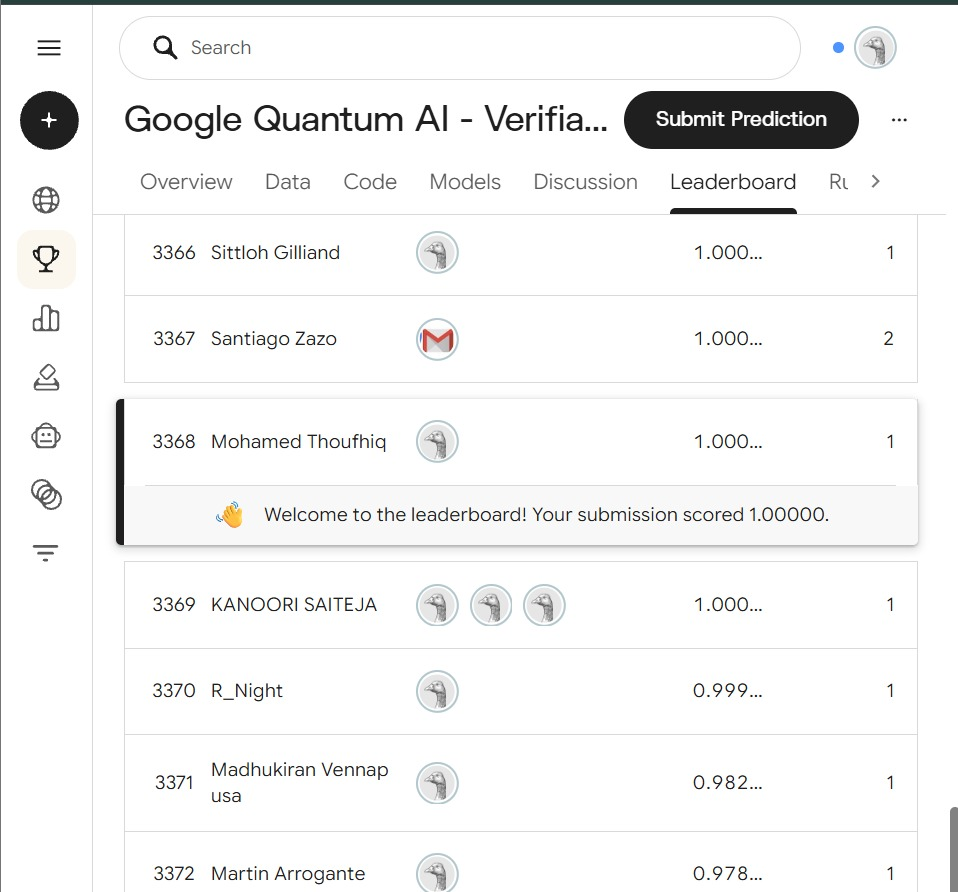

# Google Quantum AI — Verifiable Quantum Circuit Compilation

A technical case study of my participation in the Kaggle **Google Quantum AI — Verifiable Quantum Circuit Compilation** competition.

## Competition and public notebook

- **Competition:** https://www.kaggle.com/competitions/google-verifiable-quantum-circuit-compilation
- **Public Kaggle notebook:** https://www.kaggle.com/code/mohamedthoufhiq/notebook0c18b2c9cf
- **Author:** Mohamed Thoufhiq

The Kaggle notebook is the primary source for the code experiments and competition workflow. This GitHub repository provides a concise project record and links to that notebook.

## Problem overview

The competition evaluates quantum circuit compilation across three benchmark tasks:

1. **DQI** — a decoder circuit benchmark. I explored circuit-level changes using KickMix and the competition's DQI reference builder.
2. **Inverse Square Root** — included in my submitted package using the supplied sample circuit.
3. **DFTHCSOS** — included in my submitted package using the supplied baseline circuit family and factorization data.

## What I implemented and what I submitted

### DQI experiments

The Kaggle notebook contains DQI experiments, including a runtime patch to the reference decoder's `_update_metadata` method. The patch combines selected mutually exclusive control conditions, applies controlled counter updates, and uncomputes temporary ancillas.

The notebook builds this experimental circuit as `dqi_metadata_optimized.kmb` and invokes the DQI verifier with a 2,048-shot diagnostic specification.

**Important distinction:** the final ZIP packaging cell in the downloaded notebook copies `sample_submission/dqi.kmb` into the submission directory. The uploaded ZIP also contains a DQI circuit of 886,118,180 bytes, consistent with the large supplied reference artifact. Therefore, I do **not** claim that the experimental metadata-optimized circuit was the DQI circuit used in the leaderboard submission.

### Submitted baseline package

The submitted ZIP contained all three benchmark tasks in the required structure. The task verifiers reported PASS for the submitted circuits:

| Benchmark | Verifier result | Verified shots |
|---|---:|---:|
| DQI | PASS | 102,400 |
| Inverse Square Root | PASS | 200,540,928 |
| DFTHCSOS | PASS | 254,464 |

The ZIP structure and integrity were also checked. The public leaderboard displayed **1.00000** and position **3367** in my screenshot on 19 November 2026. These are time-specific observations and may change.

A score of 1.00000 is the valid reference/baseline score; it is not evidence of a resource improvement over the reference circuits.

## Leaderboard evidence

The screenshot below records the public leaderboard as displayed on 19 November 2026. At that time, my entry showed a score of 1.00000 and a displayed position of 3367. These values may change as the leaderboard updates.

## Repository scope

- The public Kaggle notebook contains the experiment code and detailed development history.
- This repository documents the implementation scope, submitted artifacts, and verification outcomes.
- Competition-provided circuit files, factorization data, and the large submission ZIP are not duplicated here.

## Reproducibility

Use the public Kaggle notebook and the competition-provided KickMix environment and verifier files to reproduce the experiments. Paths and package availability in the notebook are specific to Kaggle's competition environment.

## Competition rules and reuse

Please read the official competition rules before reusing or redistributing competition code or data:

https://www.kaggle.com/competitions/google-verifiable-quantum-circuit-compilation/rules

Public code sharing for this competition is addressed in Kaggle's competition rules. The competition-associated Kaggle notebook linked above is the primary public code location for this work.

## Acknowledgements

Thanks to Google Quantum AI and Kaggle for the benchmark tasks, KickMix tooling, and verification framework.

---

**GitHub:** https://github.com/mohamedthoufhiq-cell  
**Kaggle notebook:** https://www.kaggle.com/code/mohamedthoufhiq/notebook0c18b2c9cf
